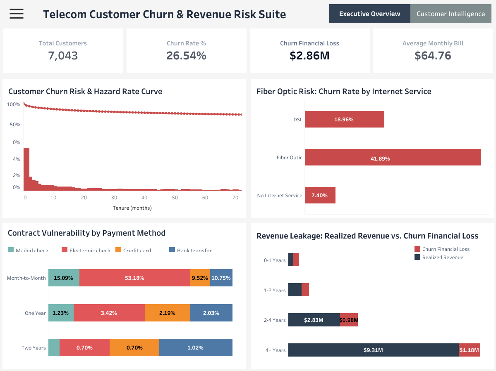
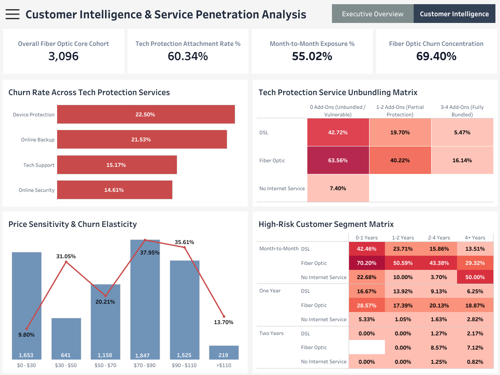

# 📊 Telecom Customer Churn & Revenue Risk Analysis

> An Interactive Two-Page Tableau Suite & Python Data Pipeline[cite: 10]

[](https://public.tableau.com/app/profile/meenakshi.singh1303/viz/Telecom_Customer_Churn_Dashboard_17953557265920/2_CustomerIntelligence)
[](scripts/data_cleaning.py)


---

## 📌 Executive Summary

This project delivers an end-to-end analytical solution designed to identify key drivers of customer attrition and quantify revenue leakage for a telecommunications provider[cite: 8, 10]. Utilizing Python for data preprocessing (`scripts/data_cleaning.py`) and Tableau for interactive business intelligence, this two-page dashboard suite translates **7,043** customer profiles into actionable executive retention strategies[cite: 8, 10, 11].

---

## 🎯 Key Business Findings

* **Financial Exposure:** Overall churn sits at **26.54%**, accounting for **$2.86M** in total churn financial loss alongside realized revenue across tenure cohorts[cite: 8, 10].
* **High-Risk Segment:** **Fiber Optic** customers show a **41.89%** churn rate overall, with high-risk segments reaching a **69.40%** Fiber Optic churn concentration[cite: 8, 9, 10].
* **Service Protection Gap:** Customers with **0 Tech Protection add-ons** experience a **63.56%** churn rate on Fiber Optic lines, compared to **16.14%** for fully bundled (`3-4 Add-Ons`) accounts[cite: 9, 10].
* **Pricing Threshold Elasticity:** Churn peaks in the **$70–$90/month** billing tier (**37.95%** churn rate) and remains elevated in **$90–$110** (**35.61%**) before dropping at **>$110** (**13.70%**)[cite: 9, 10].

---

## 🖼️ Dashboard Previews

### Page 1: Executive Overview
*High-level revenue risk tracking, hazard rate curves, contract/payment vulnerability, and realized vs. lost revenue across tenure cohorts[cite: 8, 11].*

<details>
<summary>🔍 Click here to view Executive Overview Dashboard</summary>



</details>

### Page 2: Customer Intelligence & Service Penetration
*Granular breakdown of Fiber Optic cohorts, tech protection unbundling matrices, price sensitivity elasticity, and high-risk segment heatmaps[cite: 9, 11].*

<details>
<summary>🔍 Click here to view Customer Intelligence Dashboard</summary>



</details>

---

## 🧮 Key Calculated Fields & Metric Logic

| Metric / Field | Tableau Formula / Logic | Purpose |
| :--- | :--- | :--- |
| **Realized Revenue** | `SUM(IF [Churn] = 'No' THEN [Total Charges] END)` | Cumulative charges from retained (`No`) customers |
| **Churn Financial Loss** | `SUM(IF [Churn] = 'Yes' THEN [Total Charges] END)` | Cumulative charges from churned (`Yes`) customers |
| **Total Active Cohort** | `{ FIXED : COUNTD([Customer ID]) }` | Cohort baseline count (respects context filters when applied) |
| **Cumulative Churned** | `RUNNING_SUM(COUNTD(IF [Churn] = 'Yes' THEN [Customer ID] END))` | Running cumulative count of churned customers across tenure |
| **Cumulative Retention Rate %** | `1 - ([Cumulative Churned] / MAX([Total Active Cohort]))` | Cumulative share of cohort retained across tenure |
| **MoM Churn Hazard Rate %** | `COUNTD(IF [Churn] = 'Yes' THEN [Customer ID] END) / MAX([Total Active Cohort])` | Monthly churned customer share relative to cohort baseline |
| **Tech Protection Attachment Rate %** | `COUNTD(IF [Online Security] = "Yes" OR [Online Backup] = "Yes" OR [Device Protection] = "Yes" OR [Tech Support] = "Yes" THEN [Customer ID] END) / COUNTD([Customer ID])` | Share of customers with at least one of the four tech protection add-ons |
| **Tech Services Attached** | `(IF [Online Security] = 'Yes' THEN 1 ELSE 0 END) + (IF [Online Backup] = 'Yes' THEN 1 ELSE 0 END) + (IF [Device Protection] = 'Yes' THEN 1 ELSE 0 END) + (IF [Tech Support] = 'Yes' THEN 1 ELSE 0 END)` | Count (`0`–`4`) of active tech protection add-ons per customer |
| **Tech Protection Bundle Tier** | `IF [Tech Services Attached] = 0 THEN '0 Add-Ons (Unbundled / Vulnerable)' ELSEIF [Tech Services Attached] <= 2 THEN '1-2 Add-Ons (Partial Protection)' ELSE '3-4 Add-Ons (Fully Bundled)' END` | Categorizes unbundled, partial, and fully bundled protection tiers |

---

## 🏗️ Data Architecture & Pipeline

```text
├── assets/                                  # High-resolution dashboard screenshots
│   ├── 1_Executive_Overview.png            
│   └── 2_Customer_Intelligence.png         [cite: 11]
├── data/                                    # Raw and transformed dataset files[cite: 11]
│   ├── raw/                                [cite: 11]
│   │   └── WA_Fn-UseC_-Telco-Customer-Churn.csv[cite: 11]
│   └── processed/                          [cite: 11]
│       └── Clean_Telco_Customer_Churn.csv  [cite: 11]
├── docs/                                    # Executive PDF documentation[cite: 11]
│   └── Telco_Churn_Portfolio_Draft.pdf     [cite: 11]
├── scripts/                                 # Data cleaning & feature engineering scripts[cite: 11]
│   └── data_cleaning.py                     [cite: 11]
├── Telco_Churn_Portfolio_Draft.twbx         # Packaged Tableau Workbook file[cite: 11]
└── README.md                                # Project documentation[cite: 11]
